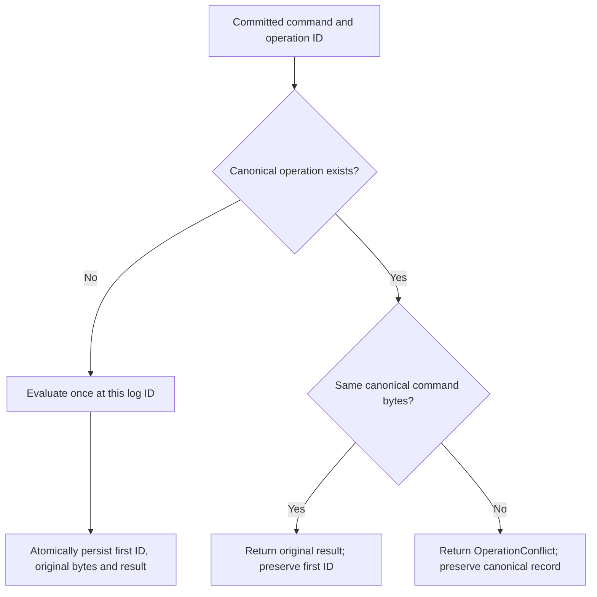
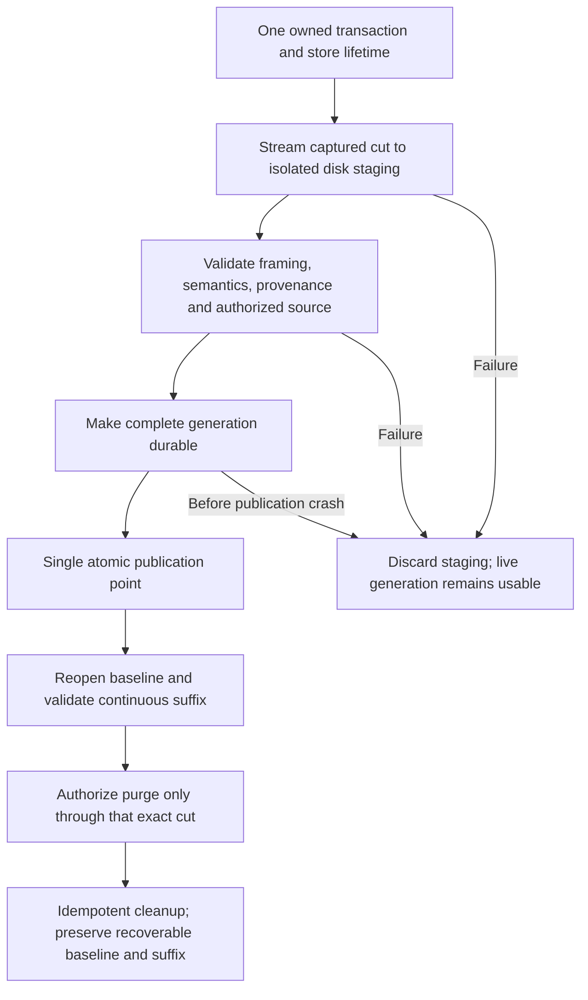

**Use this when:** changing Capture checkpoint capture, provenance, installation, recovery, or log cleanup.

# Capture checkpoint contract

This document defines the requirements for a recoverable Capture checkpoint.
It is a design contract, not evidence that production capture, installation,
purge, quorum integration, or S3 behavior implements these requirements.

## Existing evidence and the missing boundary

In `crates/capture-authority/src/application.rs`, `apply_created` inserts one
canonical command and result on the first decision for an operation ID. An
identical command returns that stored result; a different command returns
`OperationConflict` without replacing the canonical record. The first result
remains authoritative even when later state would produce a different result.

`CreatedOperation` in `crates/capture-authority/src/created.rs` contains command
bytes and a result. Only `CreatedResult::Created` carries `decision_log_id`.
Negative results carry no first-decision ID. Heads, versions, events, and
operations therefore cannot reconstruct the source of every first decision.
For example, a stored `HeadMismatch` records an observed head, but does not
prove that the head existed at the original decision cut. Later retries do
not supply the missing historical evidence.

`validate_application` in `crates/capture-authority/src/application.rs` derives
first operation IDs from retained log/application records and, for native
schema 4, replays decisions from the beginning using in-memory maps and sets.
That intact-prefix validator is evidence for existing behavior; it is not a
checkpoint-baseline validator or a bounded recovery algorithm.

The `Row` comment and `StagingSink` in
`crates/capture-authority/src/snapshot.rs` reserve operation provenance for
caller validation and require isolated staging. Rows remain opaque to the
framing decoder. A framing digest detects byte corruption; it does not establish
semantic consistency, historical truth, or authority to install a checkpoint.

## Canonical operation provenance

Checkpoint-capable storage must use an explicitly versioned operation envelope
containing the full first-decision `LogId` and the existing canonical operation
bytes, including their stored result. Preserve those bytes and result; do not
recompute a negative result against checkpoint-time heads or binding state.
The envelope version is a storage capability boundary, distinct from the
snapshot framing version. The existing CSNP v1 framing and header must not be
silently extended. Header capability metadata requires a declared framing
revision or an authenticated, versioned manifest whose consistency with the
captured header is validated. Distinct storage and framing versions do not
permit silently changing the v1 format.

The first insertion must atomically record the envelope, application response,
applied position, and any successful head/version/event changes in the same
write transaction. Its first-decision ID must identify that insertion's log
entry. An identical-command retry returns the original result and leaves both
bytes and first-decision ID unchanged. A conflicting-command retry records its
own application response as `OperationConflict`; it cannot overwrite the
canonical envelope or claim to be the first decision.

## Compatibility and promotion

The existing schema 3 to schema 4 migration remains unchanged. Adding provenance
requires a separately declared storage capability with explicit readers, writers,
upgrade, and downgrade rules. A schema 4 label alone must not imply provenance
support. Unknown envelope versions and stores missing required provenance must
be rejected by checkpoint installation and purge authorization.

An old schema 4 store may backfill first IDs only from its complete, intact,
validated prefix: replay and validate the original command/results, identify the
first canonical insertion for each operation, then atomically persist the
capability and envelopes. A retry's ID or a successful event's ID cannot stand
in for missing negative provenance. If the prefix has already been removed or
cannot be validated, refuse promotion and cleanup; do not invent IDs. Readers
without the new capability must refuse the upgraded format rather than silently
interpret it as the old operation encoding. Retaining all history forever is
not the checkpoint design: validated promotion supplies a recoverable baseline
that permits bounded suffix retention.

## Capture cut and resource ownership

Capture must read the header, heads, versions, events, and operations through
one owned read transaction. The view must retain the owning store/database
handle for the entire transaction, cursor, and output lifetime; an owned
transaction type alone does not prove database lifetime safety. Keep the store
`Arc` alive so dropping another handle cannot invalidate the view. These are
ownership requirements, not a claim about unverified library behavior.

The header must describe that same committed, applied cut with its full `LogId`,
full effective membership including its decision position and node metadata,
cluster identity, binding identity/revision, and supported storage/envelope
capabilities. Membership and binding must come from the captured transaction,
not from a later live read. Never capture beyond the durable committed position.
A four-table view without this cut and metadata is not independently installable.

Emit rows incrementally in deterministic section/key order. Bound row size,
section and total bytes, counts, temporary disk consumption, and concurrent
capture admission. Use checked arithmetic. Do not collect the whole snapshot
in RAM. Cancellation, disk exhaustion, or limit failure must leave the live
store unchanged and release task-owned staging resources.

## Isolated validation and trust

Decode only into isolated disk staging. Check framing, limits, section order,
unique keys, complete header metadata, capability versions, cluster/binding
compatibility, canonical command/result encoding, envelope IDs at or before the
cut, and all head/version/event/operation relationships. A successful operation
must agree with its version, event, and first decision. Negative operations must
have no success event or side effect attributable to that decision.

These checks still cannot prove the historical predicate behind a negative
result. Neither a digest nor a first ID proves that a `HeadMismatch`,
`BindingMismatch`, or `VersionConflict` was justified when first decided.
Remote installation therefore requires an explicitly authenticated and
authorized Raft authority for the claimed cluster, cut, and membership, or a
complete historical proof validated from a trusted baseline. Reject input that
has neither. Authentication and authorization must precede publication and
purge; a caller's assertion of trust is insufficient. This document does not
claim that this remote Raft authentication boundary is implemented.

Replay validation must use disk-backed staging/indexes and bounded buffers,
including duplicate-operation and version/head tracking. Putting the input on
disk while retaining replay maps proportional to history does not meet this
requirement. The existing `validate_application` RAM replay cannot simply be
reused to claim bounded checkpoint installation.

## Atomic publication and recovery

After isolated validation, publication must have one durable atomic point that
selects the complete checkpoint generation, its application state, cut,
membership, binding, capability, and recovery metadata. A pointer switch is
acceptable only when all referenced bytes are already durable and recovery
cannot observe a partial generation. Serialize publication with application so
no committed suffix write is lost between validation and the switch.

Preserve local node identity and persisted vote/hard state. Remote checkpoint
metadata cannot overwrite either. Validate cluster identity, binding, full cut
identity, and membership before replacing state. Reject rollback behind the
local durable application/checkpoint floor; an equal index with a different
term/leader identity is a conflict, not an equivalent cut. Retain valid local
suffix and commit state consistently with the installed baseline, rather than
resetting them from remote metadata.

On reopen, select only a fully published generation and verify its recoverable
baseline before replay. The suffix starts exactly at cut.index + 1, with checked
index arithmetic; the complete cut ID must agree wherever the boundary is
retained. Validate contiguous suffix indices, entry identities, committed and
applied bounds, typed application responses, canonical retry behavior, and
membership transitions relative to checkpoint state. Reject gaps, conflicting
boundary IDs, stale membership, or a suffix belonging to another cluster or
binding. Recovery must begin from checkpoint heads and canonical operations,
not from empty state or the assumption that the retained log starts at zero.

Purge is authorized only after the published checkpoint can be reopened and
validated as a recovery baseline. Delete only entries/results covered by that
exact cut, retaining everything needed for the continuous suffix and local
Raft durability. Re-check the selected generation and cut immediately before
cleanup. Persist a recoverable purge boundary so interrupted cleanup is
idempotent. Never delete the only evidence before provenance promotion or
checkpoint durability succeeds.

A crash before publication leaves the previous generation recoverable. A crash
after publication must recover the new complete baseline, including when purge
has not begun or is only partly complete. Orphan staging is never selected as
live state. Old generations may be reclaimed only after no active view needs
them and the selected generation remains recoverable.

## Behavioral verification requirements

The following are required behavior checks, not reports of tests run or gates
passed. Existing symbols above anchor the semantics; future checkpoint paths
must demonstrate the additional requirements directly.

| Behavior | Required observation |
|---|---|
| First negative result | Original command/result and first full ID survive capture, install, and reopen; later state does not re-evaluate it. |
| Identical and conflicting retries | `apply_created` semantics hold across the checkpoint boundary: original result/ID retained; conflict cannot overwrite the canonical record. |
| Old schema 4 promotion | An intact prefix validates and supplies first IDs; missing/corrupt prefix refuses promotion and purge; schema 3 to 4 behavior stays unchanged. |
| Snapshot cut under concurrent writes | Header, membership, binding, and all rows describe one transaction cut; later writes remain in the suffix. |
| View lifetime | Dropping other store handles during row emission cannot invalidate the retained transaction or database. |
| Framing versus authority | Valid digest with forged negative history is insufficient; unauthenticated or unauthorized remote input is rejected. |
| Cross-record corruption | Altered command, first ID, event, version, head, membership, or binding fails isolated validation before publication. |
| Recovery boundary | Exact cut plus continuous suffix recovers; gaps, conflicting full IDs, cross-cluster input, and rollback are rejected. |
| Local Raft state | Installation preserves local identity, vote/hard state, and compatible durable suffix/commit information. |
| Resource exhaustion | Oversize rows, arithmetic overflow, disk exhaustion, cancellation, and large histories fail safely within declared memory/disk bounds. |
| Crash publication | Crashes before and after the atomic point select a complete old or new generation, never a mixture. |
| Interrupted purge | Reopen succeeds before cleanup is authorized; each interruption resumes without deleting the recoverable baseline or required suffix. |

Documentation path and whitespace guards only validate document hygiene. They
cannot establish these production behaviors or the remote trust boundary.
