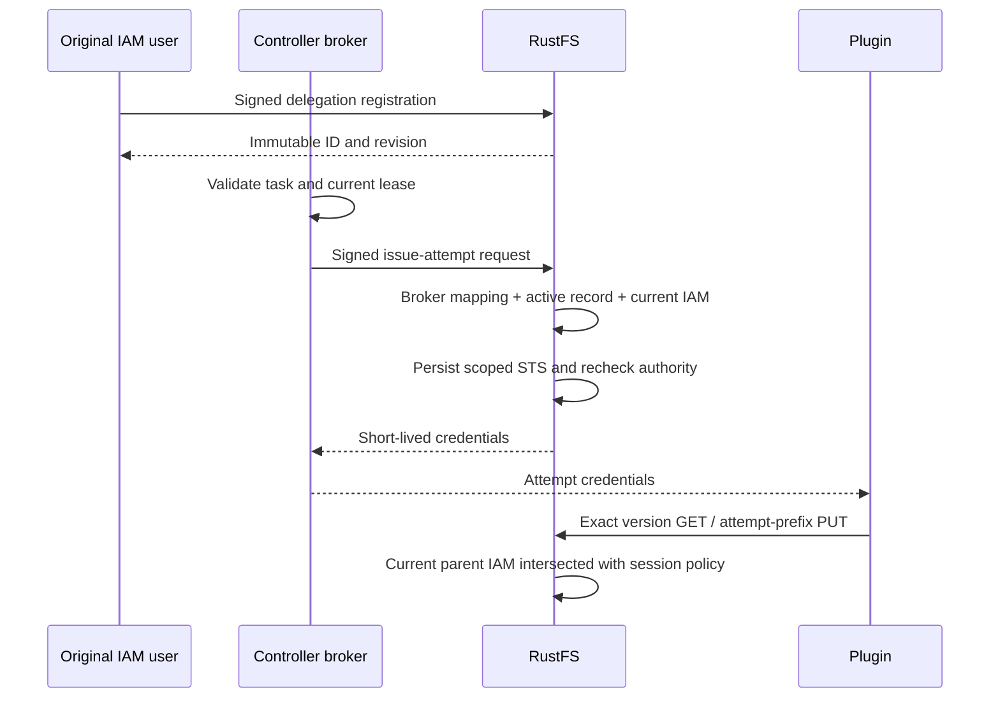

# Plugin delegation

**Use this when:** changing plugin delegation registration, revocation, broker identity, or the scope of attempt credentials.

## Authority

A delegation is an immutable restriction record owned by an ordinary IAM user. It is neither a permission grant nor a credential. Creating it requires that user's real signed request and `admin:CreatePluginDelegation`; reading and revoking require the corresponding `admin:GetPluginDelegation` and `admin:RevokePluginDelegation` actions. Root, temporary credentials and service accounts cannot own records.

The record binds a deployment, bucket, literal input and output prefixes, and an expiry of at most 24 hours. Wildcards, control characters and IAM variable expressions are rejected. Its random ID is also its immutable revision. There is no update operation.

The Controller is responsible for validating accepted task identity, current lease, epoch, node session and control generation before requesting credentials. RustFS authenticates the configured broker and enforces the delegation and current parent IAM. RustFS does not independently verify a remote Controller lease.



## Persistence and revocation

`crates/iam/src/delegation.rs` owns record validation and immutable revocation tombstones. Records use the existing IAM store under `config/iam/plugin-delegations/v1`. Writes require a successful readback. Revocation is idempotent and durable; it does not delete or overwrite the restriction record.

`ObjectStore::load_iam_config_strict` distinguishes a missing object from an empty object, invalid JSON or failed decryption. Only a genuinely absent tombstone permits an active record. Corrupt or unavailable storage rejects access rather than treating revocation as absent. Existing non-delegation readers keep their compatibility behavior.

Revocation prevents future issuance. It does not promise immediate invalidation of credentials already delivered; those remain subject to their expiration and current parent IAM. Registration, IAM changes and issuance are not one atomic transaction. Issuance rechecks after persistence and deletes the generated STS account if authority changed. Failed persistence or invalidation acknowledgment is reported as unknown issuance, never as safe retry permission.

Manual job submission reads the active delegation before calling the Runner. A submission that passed this check is in flight and may be admitted if revocation races with the outbound request; revocation prevents submissions whose authority check occurs afterward, but does not cancel an admitted job. Callers must treat a successful submit receipt as accepted work even if the delegation is revoked later. After an ambiguous timeout or service error, retry the same idempotency key while the delegation remains active; after revocation or expiry, query status instead of retrying submission.

`POST /rustfs/admin/v3/plugin-delegations/{id}/runs/query` accepts `{version:1,run_id}` and requires an ordinary IAM user with `admin:GetPluginRun` who owns the delegation in `{id}`. It reads the immutable owner record without checking expiry or revocation, then queries Runner using the record's delegation ID and revision and the authenticated access key. The result can contain only that caller's run status and committed manifest; it does not perform object reads or reauthorize object access. The Runner response must match the requested run ID and the strict status schema before RustFS returns it.

## Broker profile

`rustfs/src/admin/handlers/plugin_attempt.rs` implements `POST /rustfs/admin/v3/plugin-delegations/{id}/issue-attempt`. The signer must be an ordinary IAM user with `admin:IssuePluginAttempt`, independently listed in `RUSTFS_PLUGIN_BROKERS`:

```json
{"broker-access-key":"deployment-name"}
```

This configuration contains public access keys, not secrets. It is immutable per process. Missing or invalid configuration disables broker issuance. The broker is a trusted Controller identity; ordinary users cannot substitute their own request fields for Controller validation.

The request carries `tenant`, `run_id`, `attempt_id`, `revision`, `deployment`, `input_bucket`, `input_key`, `input_version`, `output_bucket`, `output_prefix` and `ttl_seconds`. IDs must be non-nil. The first profile accepts one exact input version, one bucket, and an output prefix equal to:

```text
<delegation-output-prefix><lowercase-hex-tenant>/<run-uuid>/<attempt-uuid>/
```

The session policy permits only `s3:GetObjectVersion` for that input with an exact `s3:VersionId`, and `s3:PutObject` beneath that attempt prefix. Credential lifetime is at most 900 seconds and cannot exceed delegation expiry. The Controller must additionally cap it to its validated lease and hard deadline.

The original user's current IAM remains the parent permission boundary on every S3 request. The server's signing key only seals the token; it is not the plugin's authorization identity. Broker identity and original user identity are separate.

External policy plugins must be disabled: their authorization path does not enforce this built-in session-policy boundary. Initializing, failed and ready plugin states all reject issuance. Attempt tokens carry a signed, persisted marker: after restart or on another node, marked credentials are accepted only by built-in STS authorization. A denied marked request returns a terminal error, so public bucket policies cannot bypass its session scope. The first profile also rejects parent policies containing conditions, because a broker request cannot reconstruct the original user's IP, MFA or other request context. It does not silently replace that context with the broker's.

## Response and failures

Successful issuance returns `version`, `delegation_id`, `delegation_revision`, `owner_access_key`, `access_key_id`, `secret_access_key`, `session_token` and `expires_at_unix_seconds`, with `Cache-Control: no-store`. The Controller verifies the returned delegation and owner against the accepted caller before delivery. Credentials must never enter logs, metrics or task result manifests.

Missing records and records owned by a different user have the same read response. Revoked or expired records reject access. Storage failures remain errors. Post-persistence failures carry static `error_code`, `issued` and `issuance_unknown` facts without credentials; callers must reconcile an unknown outcome rather than automatically mint another credential.

The route/action inventory is maintained in `rustfs/src/admin/route_policy.rs`. This contract does not imply event capture, physical container cleanup, restart reconciliation or upstream release acceptance.
